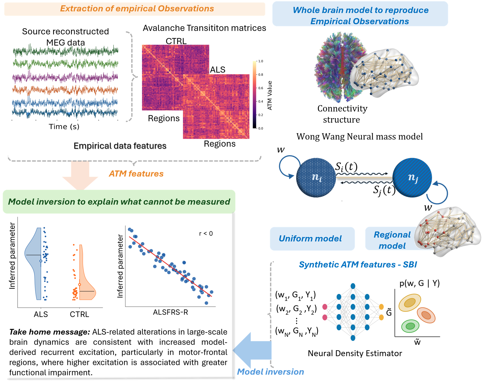

# Towards the Virtual ALS Patient

This study investigates how changes in regional excitability and large-scale coupling may contribute to altered brain dynamics in amyotrophic lateral sclerosis (ALS). We use a stochastic whole-brain network model to relate model parameters to features of neuronal avalanche transition matrices (ATMs). A central question is whether separating motor-frontal excitability from excitability in the remaining regions provides information beyond a single global excitability parameter.

We examine two separate inference configurations:

- **Global configuration:** a common excitability parameter, W, for all regions, together with a freely varying coupling parameter, G.
- **Regional configuration:** separate excitability parameters for motor-frontal regions (WF) and the remaining regions (WNF), jointly inferred with G.

In both configurations, simulations generate six features of the directional ATM: the mean and median of the upper and lower triangles, the matrix norm, and singular-value entropy. Normalized features are used to train a neural posterior estimator. Held-out synthetic cases with known parameters are used to assess parameter recovery, posterior uncertainty and interval coverage.

The broader study applies this framework to empirical ALS and control data to examine group differences and associations with clinical outcomes. Simulations generated from inferred parameters are also compared with empirical ATM features and avalanche-size distributions to assess how well the inferred model reproduces observed dynamics. These analyses evaluate a model-based account of excitability; they do not establish a causal origin of ALS-related changes.

This repository provides the synthetic simulation and inference workflow. It includes a demo with a synthetic connectome and a study configuration requiring the original connectome, supplied separately by the user. Empirical recordings, clinical data and subject-level inferred results are not distributed here.

## Study overview



*Graphical overview of the study: extraction of empirical avalanche transition matrix features, whole-brain simulations with uniform or regional excitability, and simulation-based inference of model parameters. The figure also summarizes the empirical analyses; the notebooks in this repository provide the synthetic workflow.*

## Notebooks

Two notebooks demonstrate the study pipeline without empirical or clinical data.

1. `notebooks/01_uniform_W_G.ipynb`: explore W and G, show six ATM heatmaps and raw-signal mean/variance, then train and validate on synthetic data.
2. `notebooks/02_regional_WF_WNF_G.ipynb`: explore WF and WNF at G=1.89, then jointly infer WF, WNF and G from a separate three-dimensional bank.

The 100-point demo exploration and the 4,000-case demo simulation bank are complete. The bank is included in `data/demo_uniform4000/`, with its design and generation manifest. Final training and validation results are not yet included.

## Available synthetic banks

| Folder | Network | Parameters | Cases |
| --- | --- | --- | ---: |
| `data/demo_uniform4000/` | Synthetic demo | W, G | 4,000 |
| `data/study_global_uniform4000/` | Original study connectome | W, G | 4,000 |
| `data/study_regional_uniform20000/` | Original study connectome | WF, WNF, G | 20,000 |

Study banks contain raw synthetic ATM features and parameter values. The original connectome and all empirical and clinical tables remain excluded. Read the README and metadata within each bank before use. Training on the saved features does not require the connectome; regenerating study simulations does.

## Synthetic validation figures

- [Global W-G, 4,000 study simulations](figures/study_global_uniform4000/README.md)
- [Regional WF-WNF-G, 20,000 study simulations](figures/study_regional_uniform20000/README.md)

These figures use archived synthetic validation results. They are distinct from the freshly trained demo and from rerunning the notebooks with the default training-only normalization. Each gallery documents this distinction.

## Setup

Use an isolated Python environment (the study cluster uses Python 3.11):

```bash
python -m venv .venv
# Linux/macOS:
source .venv/bin/activate
# Windows PowerShell instead:
# .venv\Scripts\Activate.ps1
python -m pip install -r requirements.txt
python -m pytest tests
python -m jupyterlab
```

The requirements file lists dependencies; it is not a version-locked environment. Consult TEST_REPORT.md for what was actually tested. Save `pip freeze` from the study cluster before claiming exact reproduction.

## Choose the network

- `configs/demo.json`: generates a synthetic 80-region network. No private input is needed. This illustrates the pipeline and does not reproduce study results.
- `configs/study.json`: requires the original network at `data/private/connectome.npz`. A checksum verifies its identity. No weights are modified.

The source and redistribution terms of the original network must still be documented. Generic demo region labels do not identify real anatomy.

## Run the notebooks

Read the short explanations above each cell. Set `CONFIG_NAME` to `demo` or `study`. Set `RUN_GRID=True` for the first exploration run. The default grid has 100 points. Each simulation retains about 240 seconds after a 60-second transient, so even 100 runs may take hours.

The inference bank is separate. Set `RUN_BANK=True` or point `BANK_FOLDER` to an existing compatible synthetic bank. The example uses 4,000 cases; this can be changed to 20,000. Do not infer three parameters using a grid where G is fixed.

Outputs are kept in separate demo/study and uniform/regional folders. Completed simulation rows are cached. Changing settings requires a different output folder.

For parallel simulation jobs, run from the repository root:

```bash
python scripts/run_simulations.py --config configs/demo.json --mode uniform --count 100 --grid --workers 4 --output outputs/demo/uniform/exploration
python scripts/run_simulations.py --config configs/demo.json --mode regional --count 4000 --workers 4 --output outputs/demo/regional/inference_bank
```

## Validation

The test cases have known synthetic parameters. Figures show six illustrative posterior distributions, shrinkage versus z-score, true versus inferred parameters and coverage. All parameters use the same illustrative cases, without selecting good fits.

The default scaler is fitted on the training pool only. The historical full-bank option is explicitly labeled and is not an independent preprocessing evaluation. Read docs/NUMERICAL_PROTOCOL.md before comparing new outputs with the paper.

## What is not included

No empirical recordings, empirical features or scalers, clinical tables, subject posterior samples, trained subject-specific outputs or original connectome are included. Synthetic demo and study banks are included as documented above. Additional banks can be generated by the user.

Before public release, confirm source-code ownership and third-party attribution, choose the repository license, document the connectome, add the study citation and pin the tested software environment. No license is asserted on your behalf.
