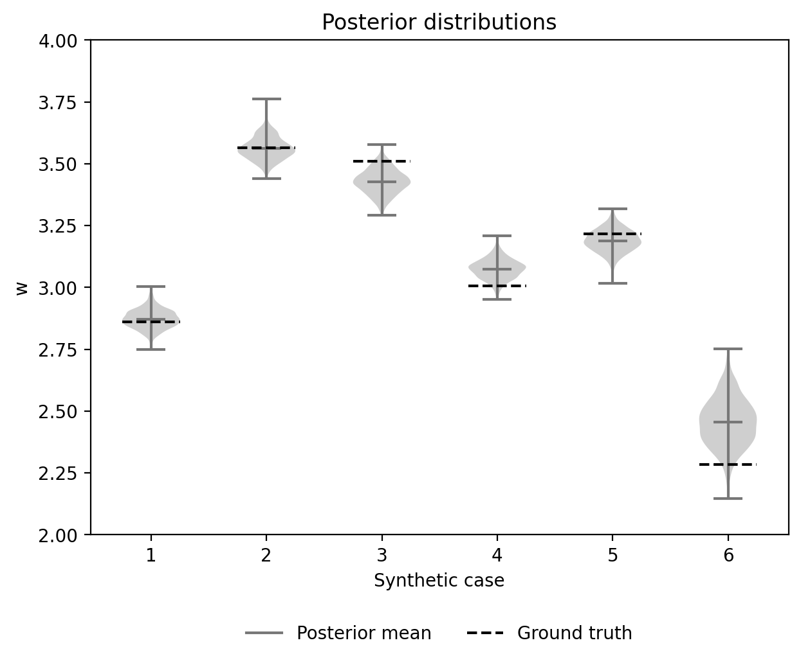
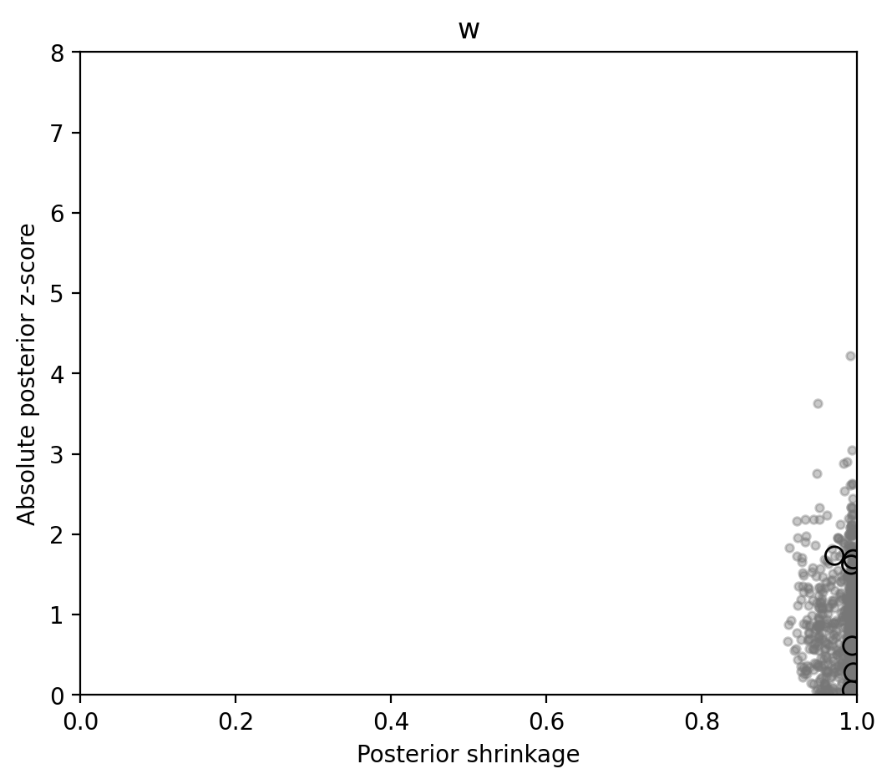
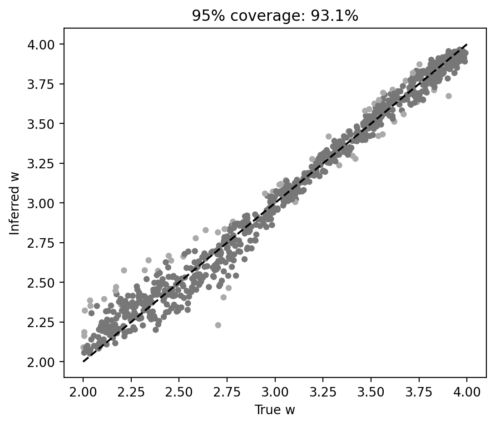
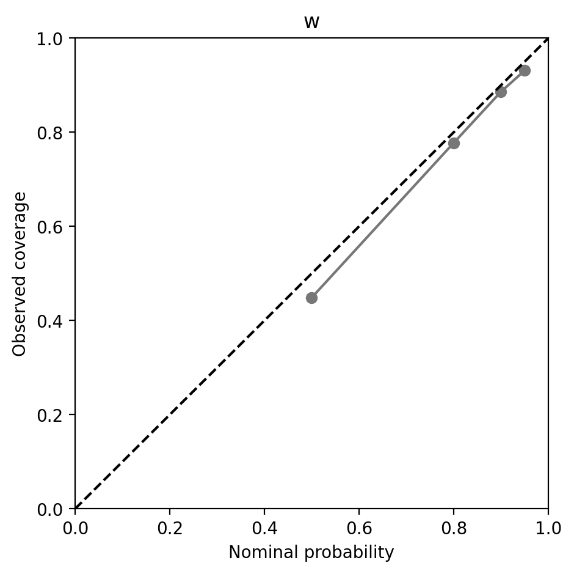
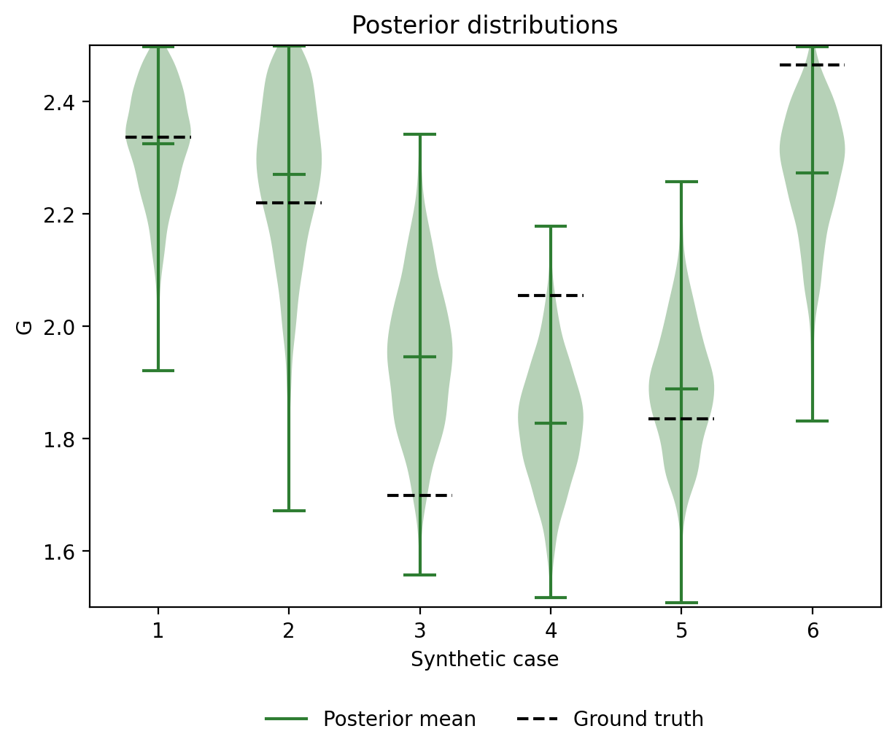
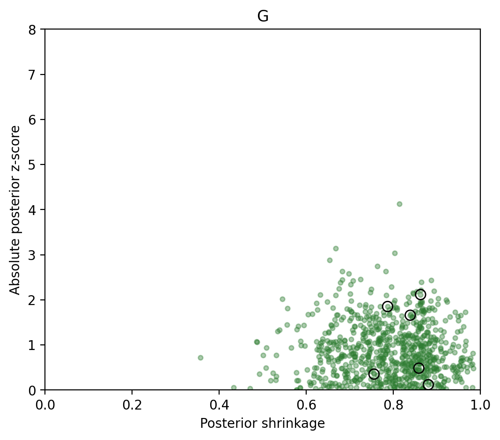
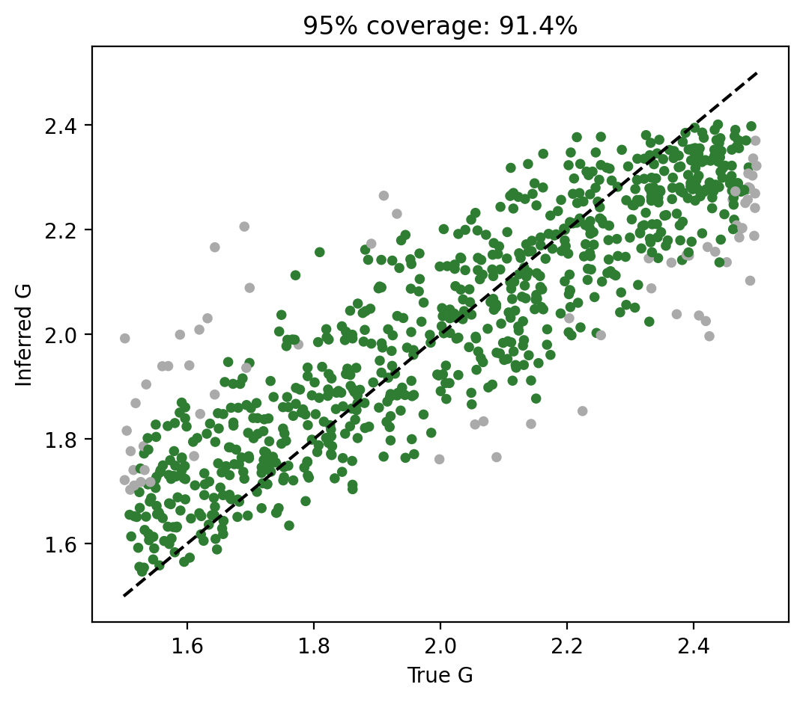
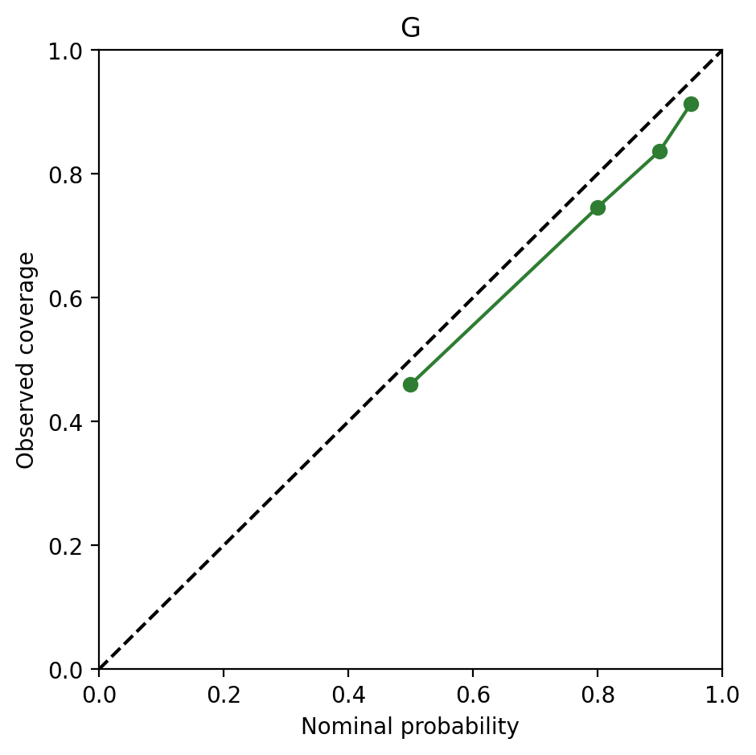
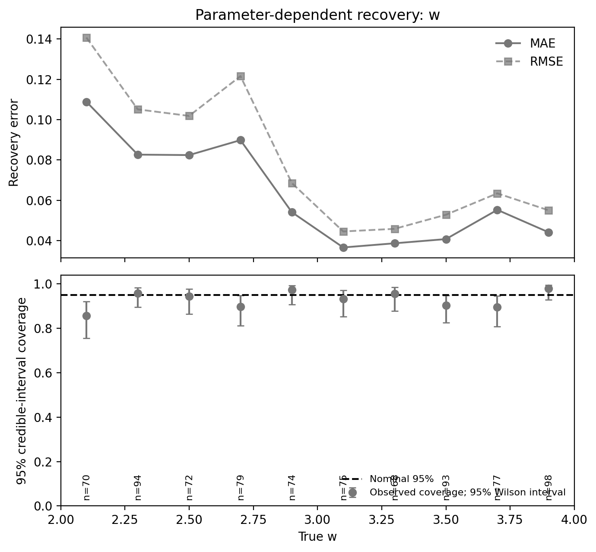
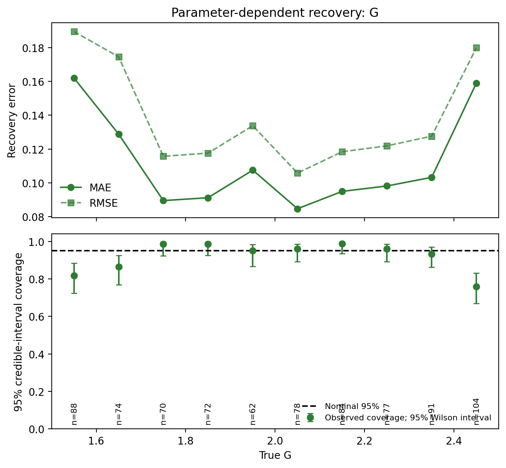

# Synthetic validation: study_global_uniform4000

Figures regenerated from archived synthetic test posterior samples. True parameters were checked against the published simulation bank. These are historical results, not a new training run with the notebook default training-only scaler. Exact reproduction requires the original split, scaler policy, fitted network and sampling settings.

Shrinkage panels use x=[0,1] and z-score y=[0,8]. Values outside those limits are not displayed. The six cases are selected at evenly spaced positions in the test array, consistently across parameters.

## w

## G

## Parameter-dependent recovery accuracy and credible-interval coverage

Equal-width bins of the true parameter (10 per parameter). Recovery errors are in parameter units. Coverage is the fraction of cases whose true value lies in the inferred 95% credible interval. Bars show pointwise 95% Wilson intervals; n indicates the number of cases per bin. Results are marginal over the other parameter. Historical preprocessing settings apply, as above.

