# Synthetic validation: study_regional_uniform20000

Figures regenerated from archived synthetic test posterior samples. True parameters were checked against the published simulation bank. These are historical results, not a new training run with the notebook default training-only scaler. Exact reproduction requires the original split, scaler policy, fitted network and sampling settings.

Shrinkage panels use x=[0,1] and z-score y=[0,8]. Values outside those limits are not displayed. The six cases are selected at evenly spaced positions in the test array, consistently across parameters.

## wf

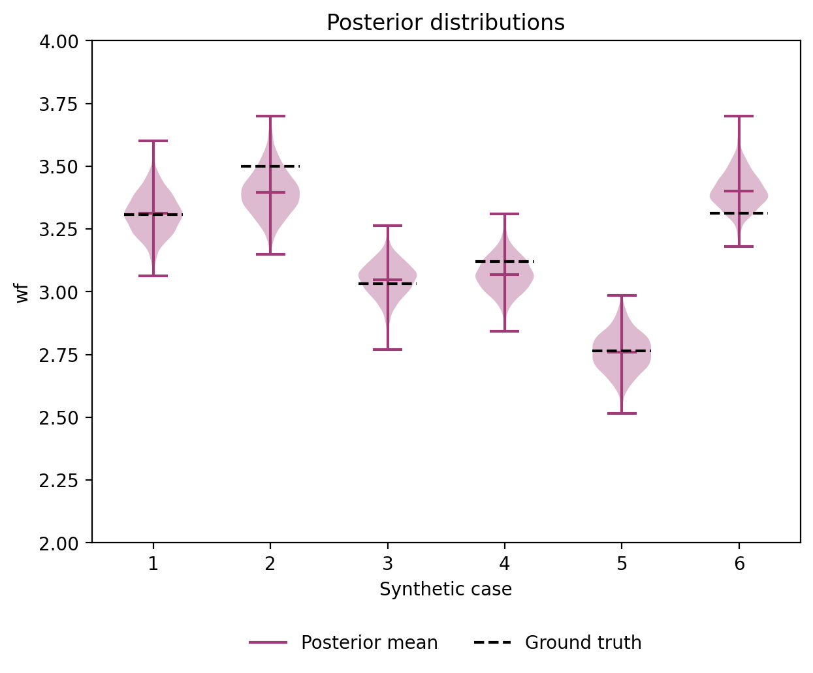

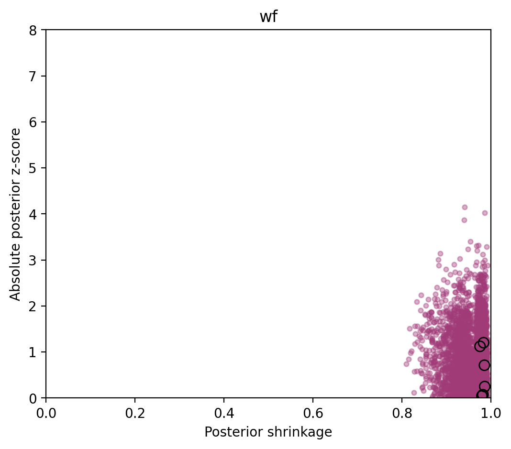

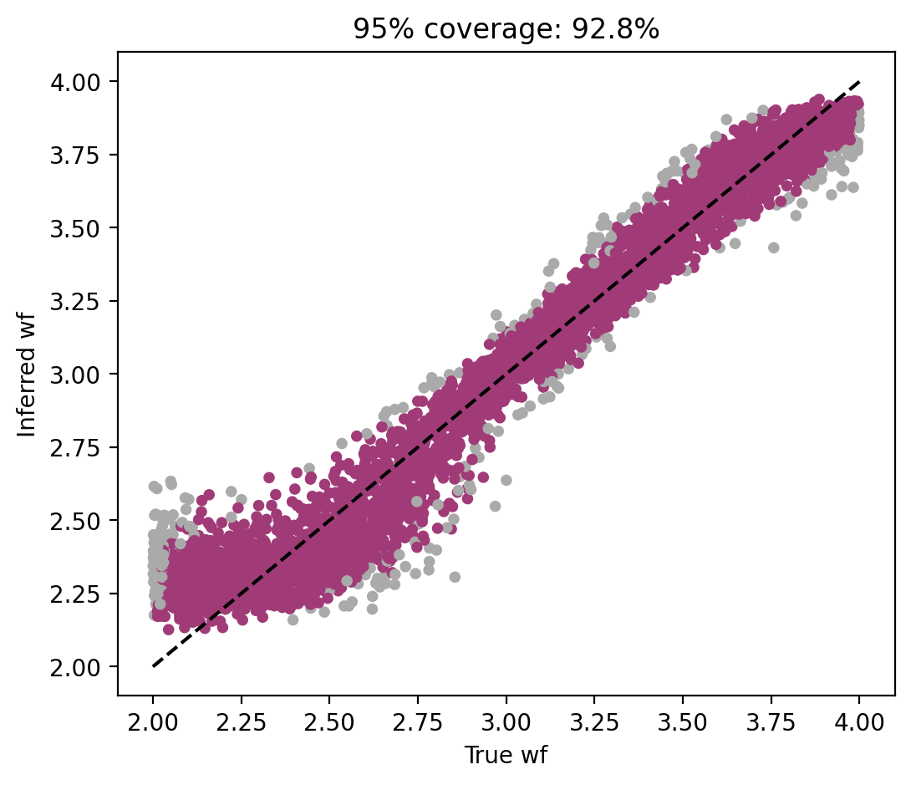

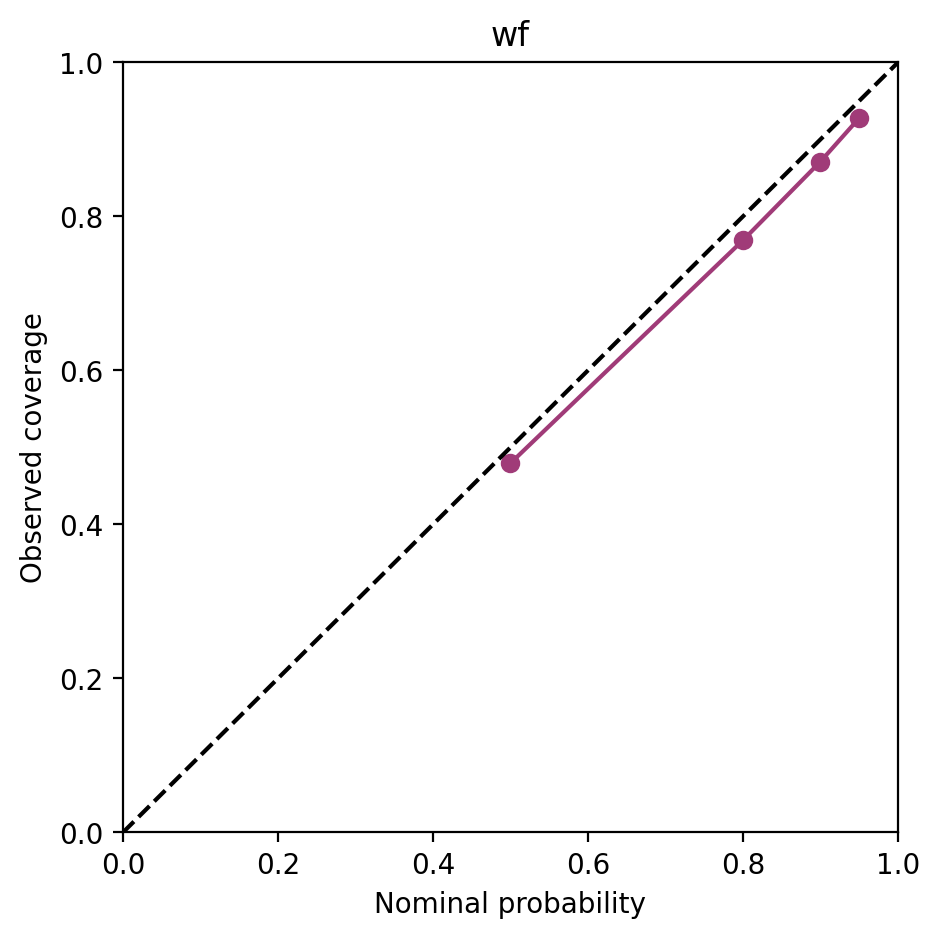

## wnf

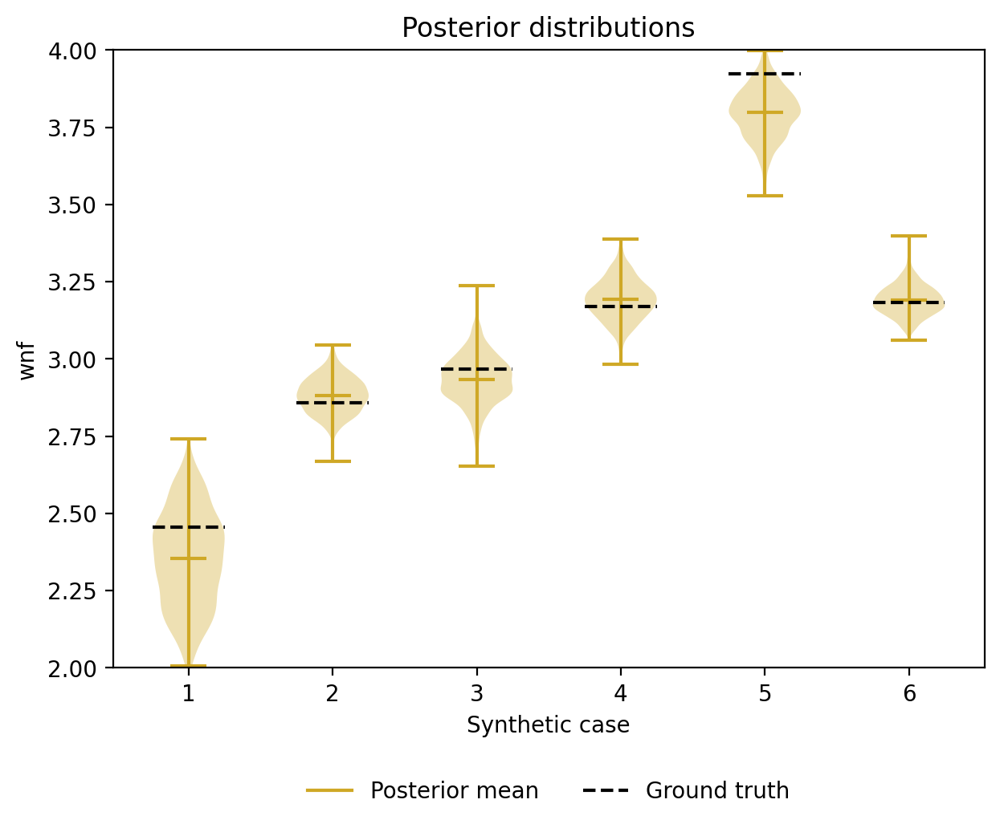

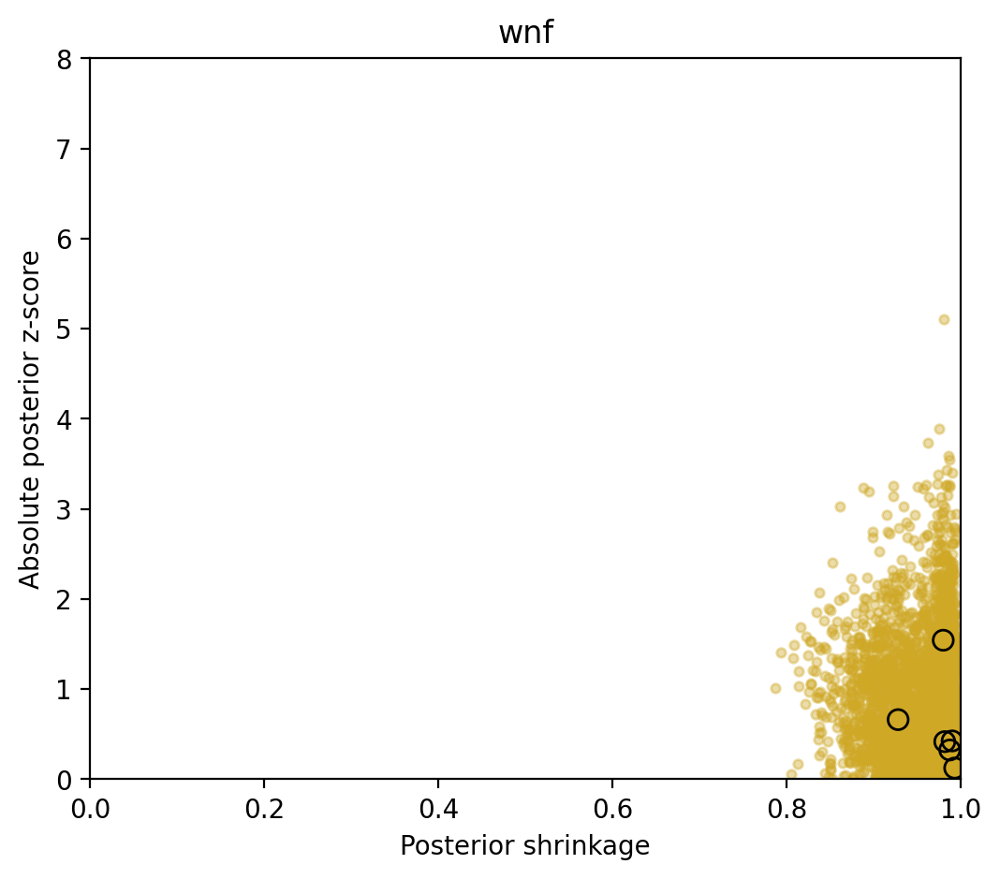

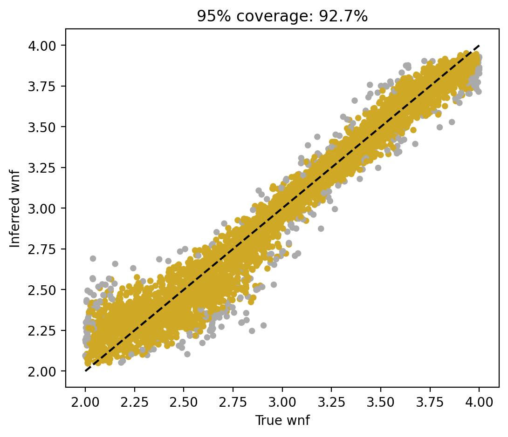

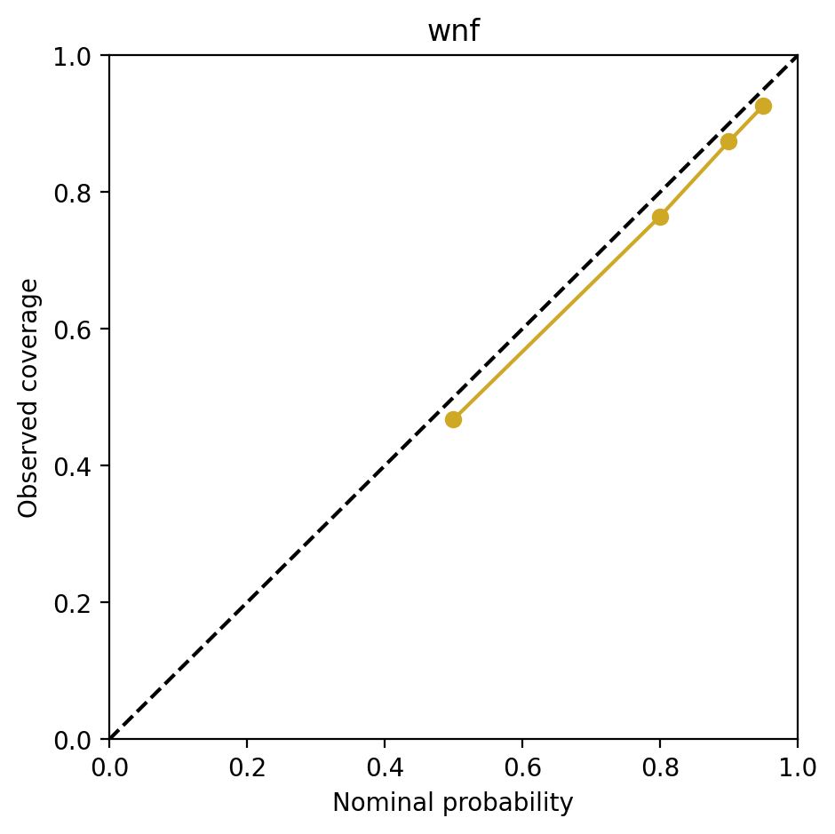

## G

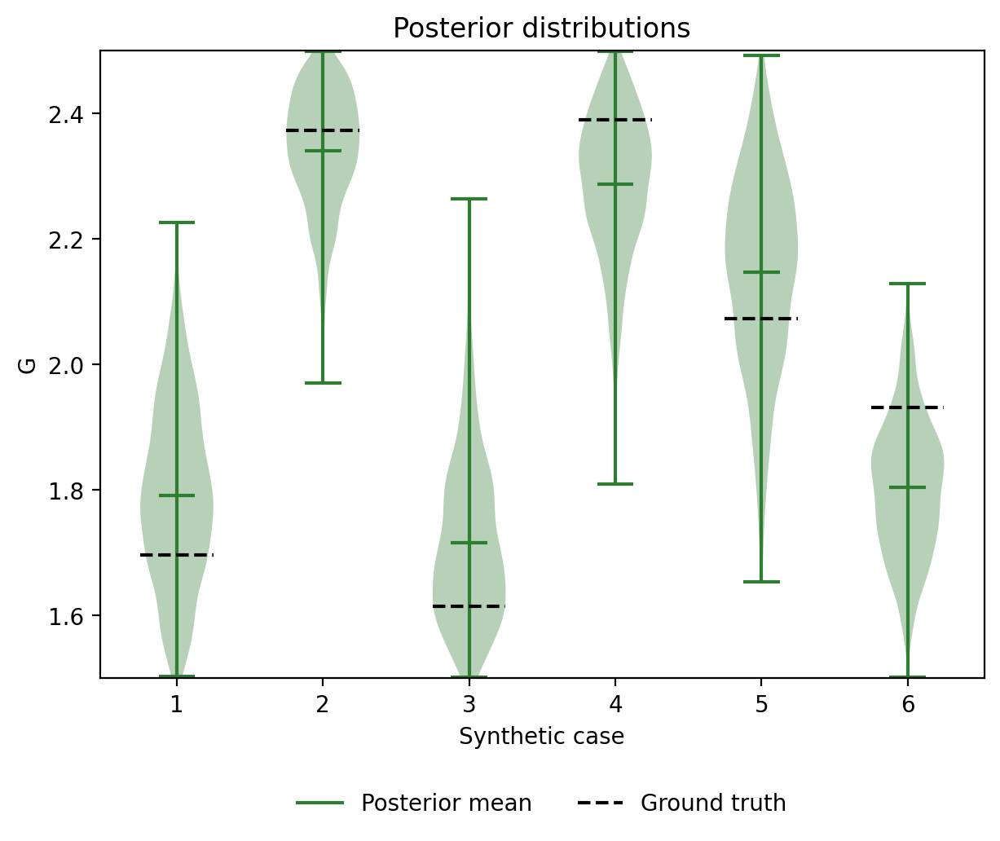

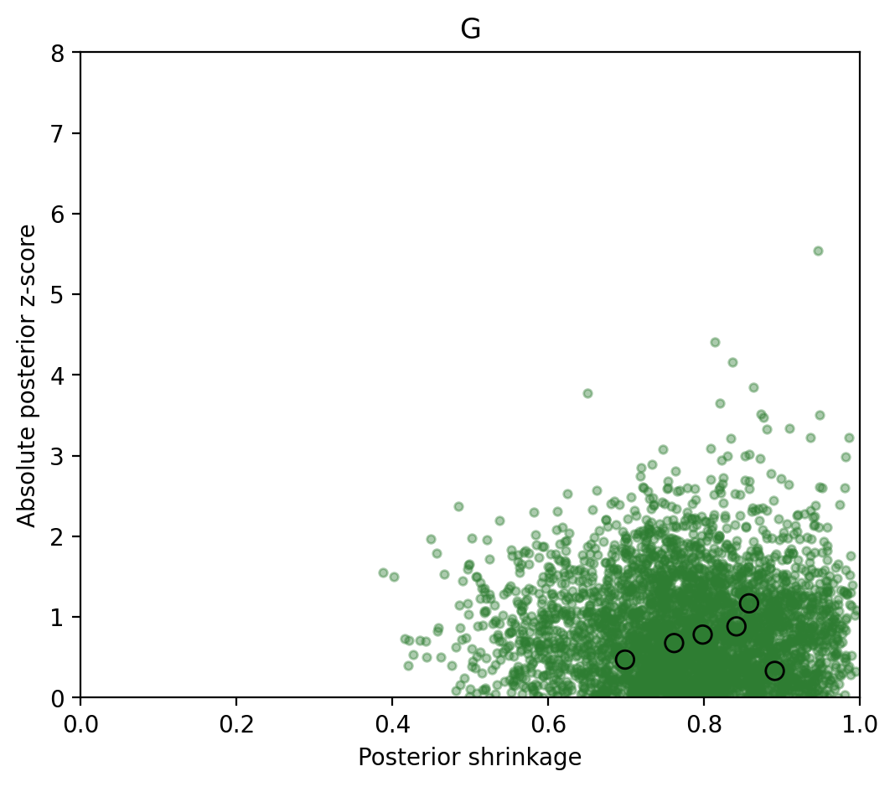

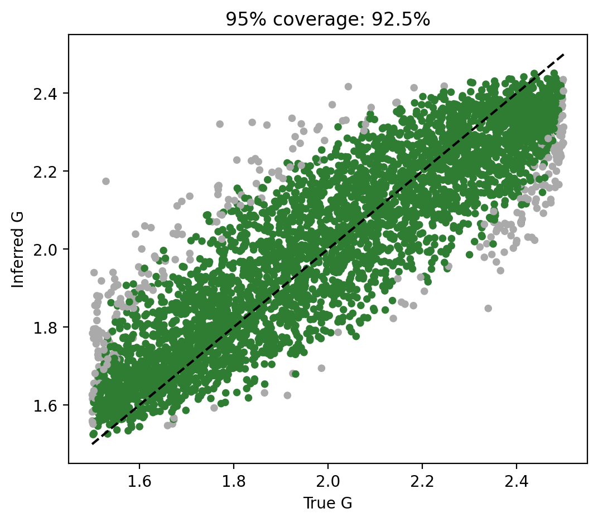

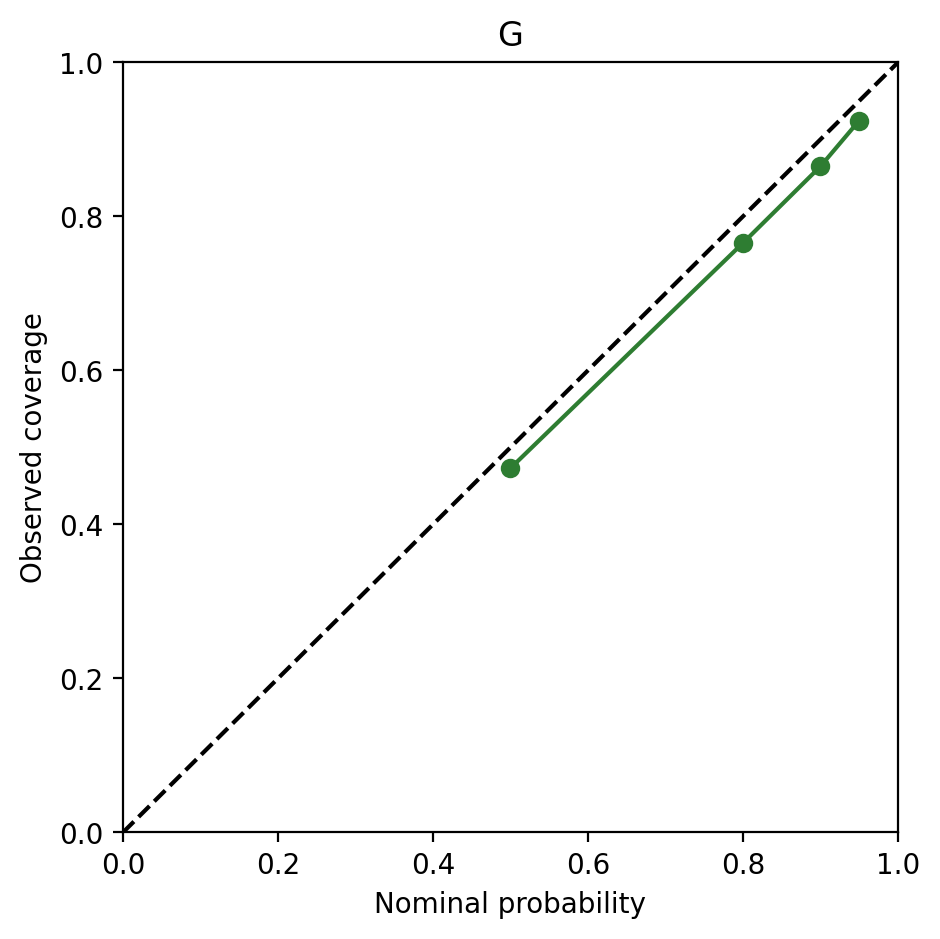

